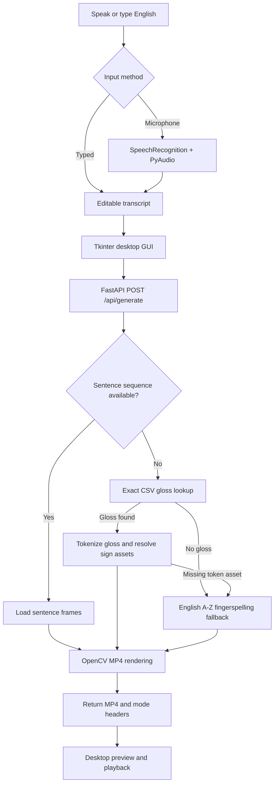

# NexusCue

**Speech-to-Indian Sign Language Representation — Python Desktop Prototype**

NexusCue is a Python desktop prototype that accepts spoken or typed English input, converts speech into text, checks available corpus sentence sequences and sentence-to-gloss mappings, generates an MP4 visual representation from available sign assets, and previews the result.

> **Scope and accuracy note:** This is a dataset-driven sign representation prototype, not a general-purpose or linguistically validated English-to-Indian Sign Language (ISL) machine-translation system. It does not invent glosses for unsupported sentences. When corpus coverage is unavailable, it can use English A–Z fingerspelling as a spelling aid, clearly labelled as a fallback—not as verified ISL translation.

## Features

- Microphone input and English (India) speech recognition.
- Editable transcript and manual text entry.
- FastAPI backend and desktop HTTP client.
- Exact normalized sentence-to-gloss lookup from CSV.
- Sentence-level sequence playback when assets exist.
- Word/sign image selection for gloss tokens.
- A–Z fingerspelling fallback for unsupported sentences or missing tokens.
- OpenCV MP4 rendering and Tkinter video preview/playback.
- Explicit dataset/fallback mode labels.

## Workflow



## Technology stack

| Technology | Purpose |
|---|---|
| Python | Main implementation language |
| Tkinter | Desktop GUI, transcript, controls and preview |
| SpeechRecognition | Speech recognition interface |
| PyAudio | Microphone audio capture |
| FastAPI | HTTP backend and API documentation |
| Uvicorn | Runs the FastAPI application |
| Requests | Desktop-to-backend HTTP communication |
| OpenCV | Image processing, frame preparation and MP4 writing |
| MediaPipe Tasks | Hand/pose landmark signals for visual suitability analysis |
| OpenCV YuNet ONNX | Face detection signal in image analysis |
| Pillow | Displays OpenCV frames inside Tkinter |
| `csv`, `pathlib` | CSV corpus access and path handling |
| `threading` | Keeps long-running microphone/API operations off the GUI event loop |

NumPy, scikit-learn, PyTorch/torchvision and torchreid were also present/used in broader dataset preparation or experimentation. Include them as runtime dependencies only if the final committed code imports them during normal application execution.

## Data and corpus

The inspected gloss CSV is `corpus_csv_files/ISL Corpus sign glosses.csv`, with columns `Sentence` and `SIGN GLOSSES`. The inspected snapshot contained 101 sentence mappings, 101 unique sentence strings, approximately 170 gloss tokens and 114 unique sign/word labels.

Other assets include:
- `Frames_Sentence_Level/` — sentence-level frames.
- `Frames_Word_Level/` — word/sign image assets.
- `Videos_Sentence_Level/` — source videos.
- `ISL_Alphabet/Training/A` through `Z` — English alphabet fallback images.
- `bulk_sentence_sequences/` — prepared sentence sequences and manifest.
- `recovered_sentence_frames_10fps/` — extracted frames for selected missing frame folders.
- MediaPipe `.task` files and YuNet/SFace ONNX model files.

This is a **file-based corpus and asset collection**, not a relational SQL database. The current prototype does not use MySQL or PostgreSQL for gloss lookup.

## Run locally

### Prerequisites
- Windows 10/11 was the development environment.
- Python 3.12.3 was used in the documented environment.
- Microphone access for speech input.
- Internet access for the current Google speech-recognition request.
- Dataset and model assets at the paths expected by the scripts.

### Install
```powershell
py -m pip install -r nexuscue_api_requirements.txt
py -m pip install -r nexuscue_desktop_requirements.txt
```

### Start backend (PowerShell terminal 1)
```powershell
py -m uvicorn nexuscue_api:app --host 0.0.0.0 --port 8000
```

- Swagger UI: `http://127.0.0.1:8000/docs`
- Health: `http://127.0.0.1:8000/health`

Keep the API terminal running.

### Start desktop app (PowerShell terminal 2)
```powershell
py nexuscue_desktop.py
```

1. Confirm backend connected.
2. Click **Start Speaking**, or type a sentence.
3. Review/edit the transcript.
4. Click **Generate Sign Video**.
5. Review the output mode label.
6. Use Play/Stop in the video preview.

## API endpoints

| Method | Endpoint | Purpose |
|---|---|---|
| GET | `/` | Root/service response |
| GET | `/health` | API and renderer availability |
| POST | `/api/generate` | Accepts `{"sentence": "..."}` and returns `video/mp4` |

Response headers:
- `X-NexusCue-Mode: dataset_sentence_or_gloss`
- `X-NexusCue-Mode: english_fingerspelling_fallback`
- `X-NexusCue-Transcript: <submitted sentence>`

## Validation snapshot

- `are you free today` mapped to `YOU FREE TODAY`.
- Case/punctuation variation of that sentence normalized to the same mapping.
- `how are you` and `I want to learn programming` were confirmed as unsupported exact mappings.
- The sequence builder produced 656 visual-group sequences for 96 sentences and copied 18,747 frames.
- Four missing frame folders were recovered from source videos; one additional sentence used a known alternate folder name.
- The validation utility reported 101/101 sentences READY, 0 missing, 0 unreadable selected frames and 2,476 selected frames inspected. This checks asset availability/readability, not linguistic correctness or manual review of every sequence.
- Supported and unsupported generation requests both returned HTTP 200 with `video/mp4` after the Windows UTF-8 subprocess fix.
- The user manually confirmed the desktop speech → transcript → generation → playback workflow.

## Important limitations

- Exact sentence matching limits coverage; semantically similar wording may not match.
- English alphabet fingerspelling is not ISL grammar or a verified sentence translation.
- Still images and selected frame sequences do not guarantee linguistically correct sign production.
- Visual clusters are not verified signer identities; the inspected spreadsheets do not contain signer IDs for every frame.
- Some sentence sequences may show visual variation and should not be described as a continuous single-signer performance unless verified.
- Speech recognition uses Google's online recognition service; it requires internet and sends captured audio to that service.
- The Python backend must be running and reachable. This is not yet an Android APK or a fully offline mobile application.
- The prototype API is not hardened for public internet exposure.

## Repository publication checklist

- [ ] Run API and desktop app from a clean terminal.
- [ ] Verify no machine-specific absolute paths remain.
- [ ] Add `.gitignore`; exclude virtual environments, caches, generated MP4s and logs.
- [ ] Review corpus/model licences and redistribution permissions before committing assets.
- [ ] Keep credentials, tokens, personal data and private configuration out of Git.
- [ ] Consider Git LFS or documented external asset download for large files.
- [ ] Add screenshots/demo video captured from the real running application.
- [ ] Add a licence only when you have the right to license all included content.
- [ ] Tag the preserved desktop baseline after final testing, e.g. `desktop-v1.0.0`.

## Roadmap

1. Preserve the Python desktop baseline in version control.
2. Make the repository reproducible and document data/model setup.
3. Develop an Android/Kotlin client against a stable API contract.
4. Decide whether Python will run remotely, on a local network or be redesigned for offline Android.
5. Expand coverage using properly annotated ISL data.
6. Evaluate linguistic validity with qualified ISL reviewers before making translation-accuracy claims.

## 📚 Documentation

- [Dataset Setup Guide](DATASET_SETUP.md) – Download links, dataset extraction, folder structure, and setup instructions.
- [Technical Documentation](TECHNICAL_DOCUMENTATION.md) – Project architecture, implementation, libraries, and workflow.
- [Technical Report (DOCX)](NexusCue_Technical_Documentation.docx) – Detailed project report.
- [Architecture & Flow Diagrams](docs/diagrams/) – System architecture and processing flow diagrams.