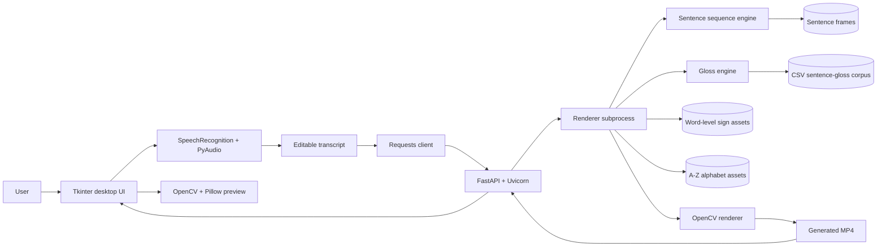
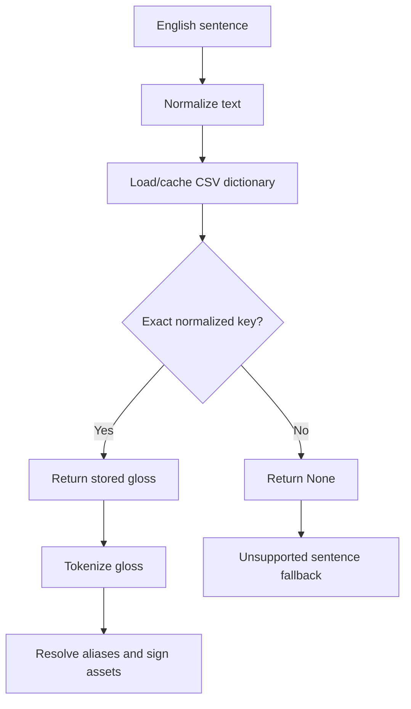
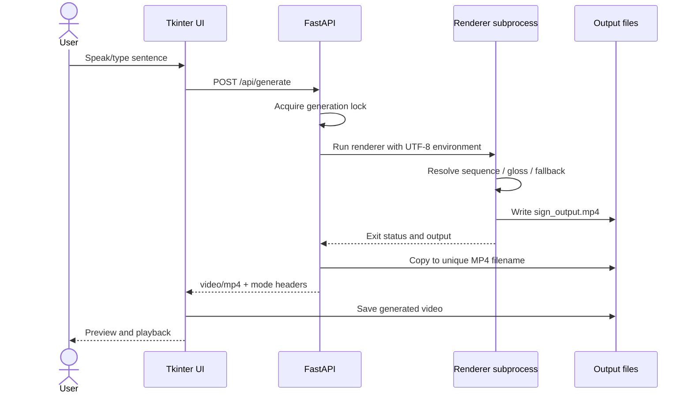

# NexusCue — Technical Documentation and Development Report

**Project:** NexusCue  
**Module:** Speech-to-Indian Sign Language visual representation  
**Release target:** Python desktop prototype  
**Purpose:** Preserve the completed desktop implementation, explain design and implementation decisions, and provide a handover for GitHub version control and future Android/Kotlin integration.

## 1. Project overview

NexusCue accepts an English sentence through microphone input or manual typing. Speech is transcribed into editable text, sent to a Python backend, checked against available corpus sentence sequences and exact sentence-to-gloss mappings, rendered into an MP4 from available assets, and displayed in the desktop preview.

The system is modular: Tkinter desktop client, speech recognition, FastAPI service, corpus/gloss engines, sign asset selection, OpenCV rendering and playback.

### 1.1 Scope and terminology

The current implementation is a **dataset-driven sign representation prototype**. It is not a trained, general-purpose English-to-ISL translation model. It does not infer or fabricate linguistically correct glosses for arbitrary English sentences. If the dataset does not support the input, the fallback may spell English words using A–Z images. This is a spelling aid, not verified ISL translation.

The corpus is a file-based collection (CSV, frame folders, videos, model assets), not a relational SQL database. No MySQL/PostgreSQL database is required by the current gloss lookup implementation.

## 2. Requirements

### Functional
1. Capture spoken English through a microphone.
2. Convert speech into text.
3. Allow manual text entry and transcript editing.
4. Send the sentence to the Python backend.
5. Prefer an available sentence-level frame sequence.
6. Otherwise perform exact sentence-to-gloss lookup.
7. Resolve gloss tokens to available sign assets.
8. Use an explicitly labelled alphabet fallback when data is unavailable.
9. Generate and return an MP4.
10. Preview and play/stop the video.

### Non-functional
- Keep the GUI responsive during speech capture and video generation.
- Separate UI from rendering logic through an API.
- Do not invent missing gloss mappings.
- Clearly label fallback output.
- Preserve a reproducible desktop milestone before Android conversion.

## 3. Architecture



| Module/file | Responsibility |
|---|---|
| `nexuscue_desktop.py` | Tkinter UI, microphone flow, transcript editing, API request, MP4 saving and playback |
| `nexuscue_api.py` | FastAPI routes, request handling, renderer subprocess, output file handling and response headers |
| `gloss_engine.py` | CSV loading, normalization, exact sentence-to-gloss lookup and dataset statistics |
| `sentence_sequence_engine.py` | Resolves prepared, recovered and original sentence-level frame sequences |
| `create_sign_video.py` | Chooses rendering route, selects assets, handles fallback and creates MP4 |
| `bulk_sentence_sequence_builder.py` | Prepares sentence sequence folders and manifest |
| `recover_missing_sentence_frames.py` | Extracts frames from source videos for selected missing frame folders |
| `validate_all_nexcue_sentences.py` | Checks availability/readability of selected sentence frames |

## 4. Dataset selection and organization

The inspected corpus files include:

| Path/asset | Purpose |
|---|---|
| `corpus_csv_files/ISL Corpus sign glosses.csv` | Sentence-to-gloss dictionary |
| `Frames_Sentence_Level/` | Sentence-level visual frames |
| `Frames_Word_Level/` | Word/sign images |
| `Videos_Sentence_Level/` | Source sentence videos |
| `ISL_CSLRT.txt` | Corpus annotation/reference text |
| `ISL_Alphabet/Training/` | A–Z fallback image dataset |
| `bulk_sentence_sequences/` | Prepared sequences and manifest |
| `recovered_sentence_frames_10fps/` | Recovered frames from selected videos |

### 4.1 Gloss CSV

Columns:
- `Sentence`
- `SIGN GLOSSES`

Inspected snapshot counts:
- 101 sentence mappings;
- 101 unique sentence strings;
- approximately 170 unique gloss tokens;
- 114 unique sign/word labels.

These are counts from the inspected CSV snapshot, not guaranteed future counts.

### 4.2 Other corpus inventory

The separate corpus inventory recorded approximately 700 annotated videos, 18,863 sentence-level frames, 1,036 word-level images and 100 spoken-language sentences in `ISL_CSLRT.txt`. Do not conflate these inventory counts with the 101 entries in the gloss CSV.

The inspected workbooks included 493 video/path rows in `ISL_CSLRT_Corpus details.xlsx` Sheet1, 18,863 sentence-frame paths in `ISL_CSLRT_Corpus_frame_details.xlsx`, and 1,036 word-image paths in `ISL_CSLRT_Corpus_word_details.xlsx`. These are path indexes; they do not establish verified signer identity for every frame.

## 5. Sentence normalization and gloss lookup

`gloss_engine.py` uses `normalize_text()` to:
1. lowercase text;
2. normalize curly apostrophes;
3. replace punctuation with spaces while preserving internal apostrophes;
4. remove standalone apostrophe tokens;
5. collapse repeated whitespace and trim.

`load_gloss_dictionary()` reads the CSV using `utf-8-sig`, checks required columns, skips incomplete rows and caches the dictionary with `lru_cache(maxsize=1)`.

`get_gloss(sentence)` returns the stored gloss only for an exact normalized sentence key. If no key exists, it returns `None`. No guessed gloss is generated.

Verified examples:
- `are you free today` → `YOU FREE TODAY`;
- case/punctuation variant → same mapping after normalization;
- `how are you` → no exact mapping;
- `I want to learn programming` → no exact mapping.



## 6. Sentence-level sequence preparation

Sentence-level frame sequences are preferred when available because they preserve temporal information better than isolated still images.

The bulk sequence builder read the 101 CSV sentences and prepared available sequences:
- 96 sentences had usable visual-group sequences in that build;
- 5 had no usable sequence in that pass;
- 656 visual-group sequences were produced;
- 18,747 frames were copied.

Four selected missing sentence frame folders were recovered from source videos at 10 FPS:
- `he would be coming today`: 30 frames;
- `i dont agree`: 40 frames;
- `No need to worry dont worry`: 39 frames;
- `now onwards he will never hurt you`: 40 frames.

The fifth case used an existing alternate-named folder (`which collegeschool are you from`) with 116 frames. Similar-sounding alternatives were not assumed equivalent without an explicit mapping.

`sentence_sequence_engine.py` checks, in order:
1. prepared bulk manifest;
2. explicitly registered recovered sequences;
3. original dataset sentence folder, including a known alternate folder-name mapping.

Natural filename sorting preserves frame order (e.g. frame 2 before frame 10).

### Validation
`validate_all_nexcue_sentences.py` reported:
- 101 total sentences;
- 101 READY;
- 0 missing;
- 0 unreadable selected frames;
- 2,476 selected frames inspected.

This is asset availability/readability validation, not linguistic validation or manual inspection of all 101 sequences.

## 7. Word/sign assets and visual groups

If no sentence-level sequence is used but an exact gloss exists, the renderer tokenizes the gloss and searches `Frames_Word_Level`.

Known alias examples in `create_sign_video.py` include:
- `HI` / `HELLO` → `HELLO_HI`;
- `LOVE` → `LIKE_LOVE`;
- `COLLEGE` / `SCHOOL` → `COLLEGE_SCHOOL`;
- `I`, `ME`, `MY` → `I_ME_MINE_MY`;
- `AGE` → `OLD_AGE`;
- multiword labels such as `SOMEONE`, `TAKE_CARE`, `ON_THE_WAY` are mapped to dataset naming conventions.

The inspected `signer_clusters.npz` contained 144 entries and a feature array of shape `(144, 128)`, alongside labels, words, filenames and paths. The renderer attempts to choose assets from a common visual group and falls back to the available image pool when needed.

**Identity caveat:** The spreadsheets do not provide verified signer IDs for every frame. These are visual clusters/groups, not verified person identities. Do not claim a continuous single-signer sequence unless separately verified.

## 8. Visual suitability analysis

The renderer uses:
- MediaPipe Tasks Hand Landmarker;
- MediaPipe Tasks Pose Landmarker Lite;
- OpenCV Laplacian variance for sharpness;
- OpenCV YuNet face detection (`face_detection_yunet_2023mar.onnx`).

Documented scoring weights:
| Signal | Weight |
|---|---:|
| Hand visibility | 40% |
| Pose visibility | 25% |
| Sharpness | 25% |
| Face signal | 10% |

These weights rank visual suitability only. They do not measure sign correctness, semantic similarity or translation confidence.

Model assets in the inspected project:
- `mediapipe_models/hand_landmarker.task`
- `mediapipe_models/pose_landmarker_lite.task`
- `face_models/face_detection_yunet_2023mar.onnx`
- `face_models/face_recognition_sface_2021dec.onnx`

SFace is present in the inventory; claim it is part of the runtime scoring only if the final code calls it.

## 9. Fallback design

The alphabet dataset contains A–Z subfolders under `ISL_Alphabet/Training`. The renderer caches alphabet image paths and selects an image for each letter.

Decision policy:
1. Use sentence sequence if available.
2. Otherwise use exact CSV gloss if available.
3. For missing gloss-token assets, use alphabet fallback where supported.
4. If no exact gloss exists, fingerspell the English sentence word by word.

The fallback output is labelled with `FALLBACK MODE`, `English Fingerspelling Fallback`, `Not a verified ISL sentence translation` and `ENGLISH FINGERSPELLING`.

A test with `I want to learn programming` generated a 640×480 MP4 at 10 FPS, 437 frames (about 43.7 seconds). The fallback badge and disclaimer were visually checked.

## 10. Video generation

`create_sign_video.py` uses OpenCV. Recorded settings:
- output resolution: 640×480;
- frame rate: 10 FPS;
- word/sign display duration: about 2 seconds;
- alphabet-letter duration: about 1.2 seconds;
- intermediate renderer output: `sign_output.mp4`;
- `TRANSITION_DURATION = 0.3`;
- `TRANSITION_PAUSE = 0.1`.

Frames are resized consistently. Fade transitions use the navy background rather than blending two sign images directly, avoiding ghosted/overlapping hands. Sentence-level source sequences play continuously, with fades at the beginning/end.

## 11. FastAPI backend and API

FastAPI separates the desktop UI from the renderer and provides OpenAPI/Swagger documentation. Uvicorn runs the service.

| Method | Route | Function |
|---|---|---|
| GET | `/` | Root/service response |
| GET | `/health` | Checks API and renderer availability |
| POST | `/api/generate` | Accepts sentence JSON and returns MP4 |

Request:
```json
{"sentence": "Are you free today?"}
```

Success response: `video/mp4`.

Mode headers:
- `X-NexusCue-Mode: dataset_sentence_or_gloss`
- `X-NexusCue-Mode: english_fingerspelling_fallback`
- `X-NexusCue-Transcript: <submitted sentence>`

### API sequence



### Windows Unicode issue

Initial Swagger testing failed because Windows' default `cp1252` encoding could not encode a Unicode arrow printed by the renderer. The subprocess environment was corrected using `PYTHONIOENCODING=utf-8`, `PYTHONUTF8=1`, `text=True`, `encoding="utf-8"` and `errors="replace"`. After the fix, supported and unsupported test requests both returned HTTP 200 and `video/mp4`.

The renderer writes to a fixed intermediate filename, so the API uses a lock during generation and copies the completed video to a unique API output filename. This prevents concurrent requests from overwriting the same intermediate file.

## 12. Desktop GUI and speech recognition

`nexuscue_desktop.py` uses Tkinter for:
- backend status;
- microphone start control;
- editable transcript;
- generate control;
- mode/status labels;
- video preview and Play/Stop controls.

SpeechRecognition captures microphone audio through PyAudio and calls `recognize_google(audio, language="en-IN")`. The captured audio is sent to Google's online recognition service. This requires internet and is not offline speech recognition.

Requests sends the sentence to FastAPI. The GUI saves the returned MP4 in `desktop_generated_videos`. OpenCV reads the frames; Pillow converts them to `ImageTk.PhotoImage` for display.

Microphone capture and backend generation run in worker threads so the Tkinter event loop remains responsive. UI changes are scheduled onto the Tkinter main thread.

## 13. Libraries and rationale

| Library | Use / reason |
|---|---|
| Python | Main development language; integrates corpus processing, API and GUI |
| Tkinter | Lightweight desktop interface included with Python |
| SpeechRecognition | Speech recognition wrapper and microphone workflow |
| PyAudio | Microphone stream capture |
| FastAPI | Lightweight typed HTTP service and automatic API docs |
| Uvicorn | ASGI server for FastAPI |
| Requests | Simple HTTP client for desktop/API communication |
| OpenCV | Frame processing, image resizing, visual analysis and MP4 encoding |
| MediaPipe Tasks | Hand/pose landmark detection signals |
| Pillow | Tkinter-compatible image display |
| `csv` | Reads sentence/gloss corpus |
| `pathlib` | Reliable path construction relative to project files |
| `threading` | Avoids blocking GUI during microphone/API tasks |
| NumPy | Feature/image arrays and cluster artifact handling |
| scikit-learn, PyTorch, torchvision, torchreid | Wider development/experimentation environment; list as runtime dependencies only if imported by the final runtime scripts |

## 14. Problems encountered and resolutions

| Problem | Resolution |
|---|---|
| `python` command resolved to WindowsApps alias | Use working `py` launcher |
| `mp.solutions` unavailable in installed MediaPipe | Use MediaPipe Tasks API and `.task` model files |
| Sentence punctuation/case differences | Normalize before exact dictionary lookup |
| Missing frame directories | Recover selected frames from source videos and register explicit mappings |
| Alternate folder naming | Add a narrow explicit folder-name mapping |
| Missing word assets | Use explicit alias mapping and alphabet fallback |
| No verified signer IDs | Call clusters visual groups; avoid identity claims |
| GUI blocking | Run microphone/API operations in worker threads |
| Windows `cp1252` Unicode subprocess error | Force UTF-8 environment and decoding |
| Preview area too small | Enlarge actual preview surface, preserve video aspect ratio and provide scrolling |

## 15. Testing record

### Gloss tests
- `are you free today` → `YOU FREE TODAY`.
- Case/punctuation variant mapped identically.
- `how are you` → no mapping.
- `I want to learn programming` → no mapping.

### Sequence validation
101/101 READY, zero missing and zero unreadable selected frames among 2,476 inspected frames. This checks files, not linguistic correctness.

### Visual/video checks
Representative examples checked:
- original dataset alternate folder: 116 source frames;
- recovered sequence: 40 frames;
- bulk sequence: 31 frames.

A sample source video was 640×480, 10 FPS and 123 total frames including transition frames. Visual variation within a sequence was observed; do not claim one continuous signer.

### Fallback test
`I want to learn programming`: 640×480, 10 FPS, 437 frames, approximately 43.7 seconds. The fallback label and disclaimer were visible.

### API test
- Supported sentence: HTTP 200, `video/mp4`, mode `dataset_sentence_or_gloss`.
- Unsupported sentence: HTTP 200, `video/mp4`, mode `english_fingerspelling_fallback`.

### Desktop end-to-end
The user manually confirmed microphone input, transcript display, video generation and playback. Re-run the complete test after the exact final source snapshot is committed.

## 16. Security, privacy and deployment

This is a local prototype, not a production-hardened public service. Before public deployment:
- add authentication/authorization;
- restrict CORS to trusted origins if browser clients are added;
- validate sentence length and payloads;
- add generation timeouts and concurrency limits;
- manage generated-file retention and cleanup;
- avoid exposing filesystem paths and tracebacks;
- disclose online speech recognition and obtain appropriate consent;
- use HTTPS for remote deployment;
- review corpus/model licences and redistribution permissions.

## 17. Version control and GitHub release

Suggested first commit after reviewing the final actual file tree:

```powershell
git init
git add README.md TECHNICAL_DOCUMENTATION.md docs/
git add nexuscue_desktop.py nexuscue_api.py
git add gloss_engine.py sentence_sequence_engine.py create_sign_video.py
git status
git commit -m "Preserve NexusCue desktop prototype and documentation"
```

Then connect the GitHub remote and push the branch according to the repository's actual branch name. After final tests, tag the desktop baseline:

```powershell
git tag -a desktop-v1.0.0 -m "NexusCue Python desktop prototype"
git push origin main
git push origin desktop-v1.0.0
```

Do not blindly commit the full corpus or model assets. Check licensing, file sizes and redistribution rules first. Consider Git LFS or a documented download/setup procedure for large files. Exclude virtual environments, caches, generated MP4s, logs and secrets.

Suggested `.gitignore` entries:
```gitignore
__pycache__/
*.py[cod]
.venv/
venv/
env/
.pytest_cache/
desktop_generated_videos/
api_generated_videos/
sign_output.mp4
*.log
.vscode/
.idea/
.env
.env.*
.DS_Store
Thumbs.db
```

## 18. Future development

1. Preserve the tested Python desktop version as a tagged Git release.
2. Verify corpus/model licences and provide reproducible asset setup.
3. Capture real application screenshots and a short demo recording.
4. Define a stable API contract for the Android/Kotlin client.
5. Decide whether the Python backend will be remote, LAN-hosted or reworked for offline Android.
6. Improve dataset coverage using appropriately annotated ISL data.
7. Evaluate linguistic correctness with qualified ISL reviewers/native signers.
8. Report visual asset quality separately from linguistic translation accuracy.

---

**Project summary:** NexusCue is a modular, dataset-driven speech-to-sign visual representation desktop prototype. It demonstrates an integrated microphone-to-text-to-video workflow with explicit fallback handling and is a foundation for future ISL research and Android integration.
